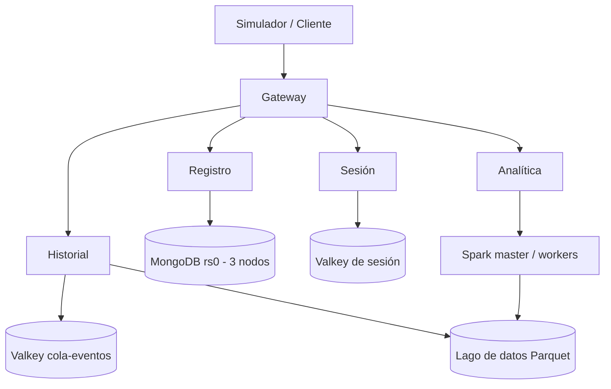

> **Borrador histórico (2026-11-15).** La versión vigente de esta sección está en `informe/informe.tex`
> (y en `informe/informe.pdf`), corregida con lo que cambió después: redes propias de MongoDB y Valkey (D15),
> plazo de la asignación renovado con latidos y borradores (D16), la sesión vencida que ahora se borra al
> recuperarla y la publicación durable de eventos (B3.6) ya verificada. Algunas limitaciones de este
> borrador ya no aplican.

# 1. Arquitectura del sistema

## 1.1 Descripción general

El proyecto implementa una plataforma distribuida para la gestión de tareas de anotación, con énfasis en datos LiDAR. Su arquitectura separa las responsabilidades operacionales, el manejo de sesiones, el historial de eventos y el procesamiento analítico mediante servicios independientes.

Los servicios están desarrollados principalmente con Python, FastAPI y Uvicorn, siguiendo las decisiones técnicas documentadas en `DECISIONES.md`. La comunicación entre servicios se realiza mediante interfaces HTTP, mientras que los motores de almacenamiento permanecen asociados a los módulos responsables de administrarlos.

Los componentes principales son:

| Componente | Responsabilidad | Tecnología |
|---|---|---|
| Gateway | Entrada pública, coordinación de asignaciones, operaciones de tareas y consulta de salud | FastAPI, httpx |
| Registro | Persistencia operacional de proyectos, tareas, asignaciones y transiciones de estado | MongoDB 7.0 |
| Sesión | Administración de sesiones, locks, borradores y actividad de anotadores | Valkey 8.0 |
| Historial | Recepción y procesamiento de eventos; almacenamiento histórico | Valkey Streams, PyArrow, Parquet |
| Analítica | Consultas sobre los datos históricos | Apache Spark 3.5.1, PySpark |
| Simulador | Generación de actividad y pruebas de carga | Python, httpx |

La separación permite que cada módulo tenga una responsabilidad definida y evita que todos los componentes accedan directamente a las mismas bases de datos.

## 1.2 Organización de servicios y almacenamiento

**Registro y MongoDB.** Registro administra la información operacional del sistema mediante un conjunto de réplica MongoDB denominado `rs0`, compuesto por tres instancias. La asignación de tareas y las transiciones de estado se realizan desde este servicio.

**Sesión y Valkey.** Sesión utiliza una instancia de Valkey para almacenar sesiones activas, borradores y locks de tareas. Los locks se identifican mediante un token UUID generado por el Gateway. La instancia está configurada con persistencia AOF mediante `appendonly yes` y `appendfsync everysec`.

**Historial y cola de eventos.** Historial recibe eventos de las transiciones operacionales. Para desacoplar la recepción de eventos de su escritura histórica, utiliza una segunda instancia de Valkey, denominada `cola-eventos`, con Streams y persistencia AOF. Los eventos se procesan en micro-lotes y se almacenan en archivos Parquet.

**Analítica y Spark.** Analítica realiza las consultas sobre los conjuntos históricos mediante una sesión persistente de Spark, conectada a su infraestructura de procesamiento. Las decisiones del proyecto contemplan conjuntos de datos `principal`, `grande` y `prueba`.

Esta distribución evita mezclar datos transaccionales, datos temporales de sesión y datos históricos en un único motor.

## 1.3 Diagrama lógico de arquitectura

El diagrama representa las relaciones lógicas principales. La topología de redes de Docker Compose proporciona restricciones adicionales de conectividad.

## 1.4 Límites de responsabilidad y aislamiento

El sistema utiliza distintas redes Docker para limitar la comunicación entre componentes:

| Red | Propósito |
|---|---|
| `borde` | Comunicación del simulador con el Gateway |
| `interna` | Comunicación interna entre servicios y motores operacionales |
| `cola` | Conectividad específica entre Historial y `cola-eventos` |
| `spark` | Conectividad entre Analítica y los componentes de Spark |

De acuerdo con las decisiones D12 y D13, el simulador se comunica únicamente con el Gateway y no necesita acceder directamente a los motores de datos. Asimismo, la instancia `cola-eventos` pertenece al dominio de Historial, mientras que la instancia Valkey de sesiones pertenece al dominio de Sesión.

El aislamiento también se aplica a las responsabilidades de software: los otros servicios utilizan las interfaces de Registro y Sesión en lugar de manipular directamente sus datos internos.

Como evidencia de la configuración y el despliegue, las pruebas B5.1 verificaron que el Gateway era el único servicio con el puerto `8000` publicado hacia el host. Los demás servicios operaban mediante la conectividad interna de Docker.

La revisión de variables de entorno, credenciales y pertenencia efectiva a cada red debe contrastarse con la configuración final de `docker compose` al integrar las ramas del equipo.

### Evidencia de aislamiento mediante Docker Compose

Se inspeccionó la configuración efectiva de Docker Compose, incluyendo el perfil `carga`, para verificar la separación de redes y las variables de entorno de cada servicio.

| Servicio | Redes Docker | Variables de conexión relevantes |
|---|---|---|
| Gateway | `borde`, `interna` | `REGISTRO_URL`, `SESION_URL`, `HISTORIAL_URL`, `ANALITICA_URL` |
| Registro | `interna` | `MONGO_URI`, `MONGO_DB`, `SESION_URL` |
| Sesión | `interna` | `VALKEY_URL` |
| Historial | `cola`, `interna` | `COLA_HOST`, `COLA_PUERTO`, `SESION_URL` |
| Analítica | `interna`, `spark` | `SPARK_MASTER`, `SESION_URL` |
| Simulador | `borde` | `GATEWAY_URL`, `IDS_JSON` |

**Resultados:** Registro no dispone de una variable `VALKEY_URL` ni pertenece a la red exclusiva `cola`. La conexión `SESION_URL` se utiliza para comunicar información de salud mediante HTTP, no para acceder directamente al almacenamiento de sesiones. Historial administra su cola de eventos mediante las variables `COLA_HOST` y `COLA_PUERTO`. Analítica dispone de una red específica para Spark.

El simulador únicamente pertenece a `borde`, mientras que Gateway pertenece tanto a `borde` como a `interna`. Esto permite que el simulador acceda al Gateway sin conectarse directamente a Registro, Sesión, Historial, Analítica o sus motores de almacenamiento.

La configuración efectiva de Docker Compose respalda las decisiones D12 y D13 mediante redes diferenciadas y conexiones explícitas entre servicios.

## 1.5 Recorrido de una tarea LiDAR

El recorrido operacional de una tarea LiDAR puede describirse mediante las siguientes etapas:

1. **Creación:** se registra un proyecto y se incorpora un lote de tareas que referencia los archivos LiDAR y su taxonomía.
2. **Solicitud:** un anotador solicita una tarea al Gateway mediante `POST /tareas/siguiente`.
3. **Asignación:** el Gateway genera un token UUID y solicita a Registro la asignación de una tarea disponible.
4. **Bloqueo:** una vez que Registro confirma la asignación, el Gateway solicita a Sesión la adquisición del lock correspondiente.
5. **Apertura de sesión:** Sesión registra la relación entre anotador, tarea, proyecto y token. Si existe un borrador recuperable para ese anotador, el flujo puede devolverlo.
6. **Edición:** el anotador guarda avances mediante `PUT /tareas/{id}/borrador`. El token permite comprobar la propiedad de la sesión y del lock.
7. **Latidos:** `POST /sesiones/latido` permite renovar el lock y actualizar la actividad del anotador en Valkey.
8. **Envío y revisión:** cuando la anotación se envía, las transiciones operacionales correspondientes se procesan a través de Registro; posteriormente pueden aprobarse o rechazarse en revisión.
9. **Historial:** los eventos de las transiciones se remiten a Historial para su procesamiento y almacenamiento en Parquet.
10. **Analítica:** Spark consulta los datos históricos para calcular indicadores y métricas del proceso.

El Gateway implementa una compensación cuando la asignación no puede completarse: intenta cerrar la sesión, soltar el lock y revertir la asignación de Registro.

## 1.6 Manejo de eventos y consistencia

La decisión D3 define un mecanismo de mensajería basado en la recepción de eventos por Historial y su incorporación a un Valkey Stream independiente, con soporte para grupos de consumidores, confirmación de procesamiento y recuperación de mensajes pendientes.

Este diseño busca desacoplar el procesamiento histórico de las operaciones del Gateway. Sin embargo, **la garantía completa de publicación durable de eventos todavía está identificada como una tarea parcialmente pendiente (B3.6)**. Por ello, no se presenta como una propiedad completamente demostrada hasta realizar la validación correspondiente.

La asignación de tareas también se coordina entre dos motores: MongoDB conserva el estado operacional de la asignación y Valkey protege el acceso mediante locks temporales. Las pruebas demostraron rechazo de tokens vencidos y reasignación después de expirar el lock.

Se identificó, no obstante, una condición de integración pendiente: los latidos renuevan el lock de Valkey, pero no actualizan automáticamente el vencimiento de la asignación en MongoDB. Esta diferencia debe resolverse o documentarse como limitación antes de afirmar consistencia completa durante sesiones prolongadas.

## 1.7 Monitoreo y recuperación

La decisión D4 establece que los servicios publican periódicamente mensajes de estado en Sesión, donde se conservan temporalmente en Valkey. El Gateway combina esos mensajes con verificaciones HTTP directas para producir una respuesta consolidada mediante `GET /salud`.

La implementación contempla estados operativos, degradados y caídos, de modo que la indisponibilidad de un servicio pueda detectarse sin detener necesariamente el resto de la plataforma.

Las pruebas ejecutadas para la Persona B aportaron las siguientes evidencias:

| Prueba | Resultado observado |
|---|---|
| B5.1 — Gateway | Rutas, respuestas de error, estados de salud y exposición del puerto público |
| B5.2 — Sesiones | Recuperación de borrador en 0.047 segundos y persistencia tras reiniciar Valkey |
| B5.2 — Locks | Reasignación después del vencimiento y rechazo HTTP 409 del token anterior |
| B5.3 — Recuperación ante fallos | Reinicio de Valkey durante actividad, con RTO observado de 1.016 segundos |
| B5.3 — Persistencia | Recuperación del borrador confirmado sin pérdida observada en esa ejecución |

En B5.3 se observaron respuestas HTTP 503 durante la interrupción y HTTP 200 después de la recuperación. La configuración AOF `everysec` implica una posible ventana de pérdida cercana a un segundo; la ausencia de pérdida en una ejecución no constituye una garantía universal.

## 1.8 Conclusión arquitectónica

La arquitectura propuesta distingue claramente las operaciones transaccionales, las sesiones temporales, el historial inmutable de eventos y el procesamiento analítico.

El Gateway concentra la entrada pública y la coordinación entre servicios, mientras que Registro, Sesión, Historial y Analítica mantienen responsabilidades y motores diferenciados. Las redes Docker y los contratos HTTP refuerzan el aislamiento modular.

Las pruebas de integración respaldan el funcionamiento de los flujos principales de asignación, recuperación de borradores, expiración de locks, monitoreo y recuperación de Valkey. Las garantías de publicación durable de eventos y sincronización de vencimientos permanecen como aspectos de integración que requieren validación adicional.